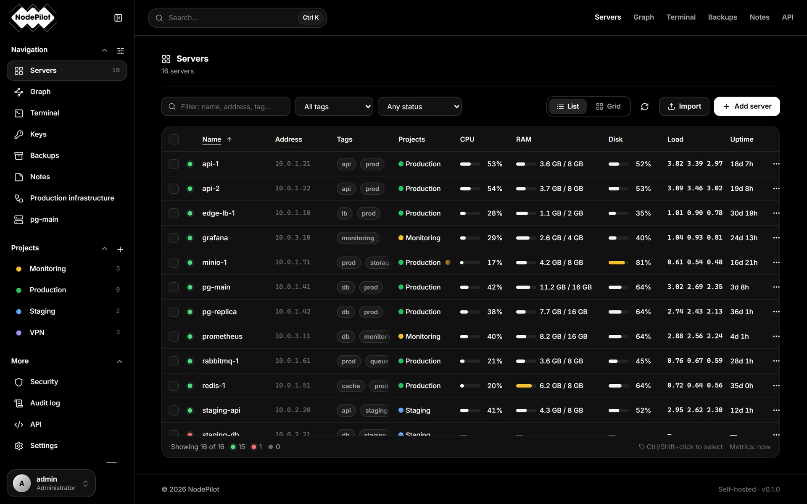
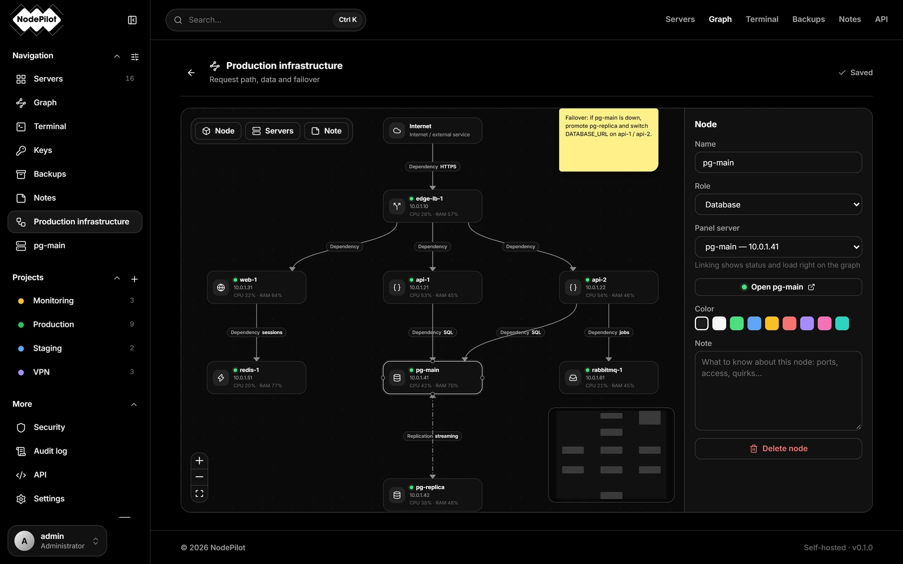
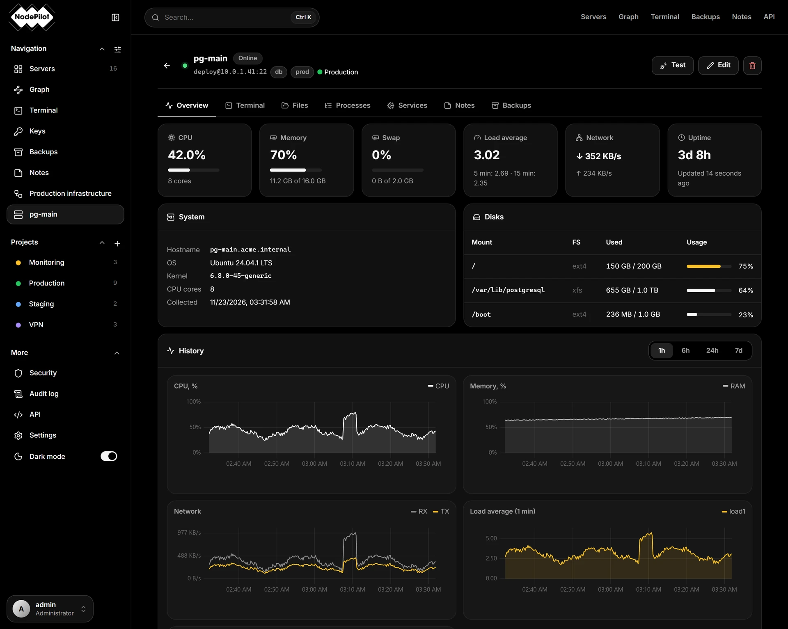
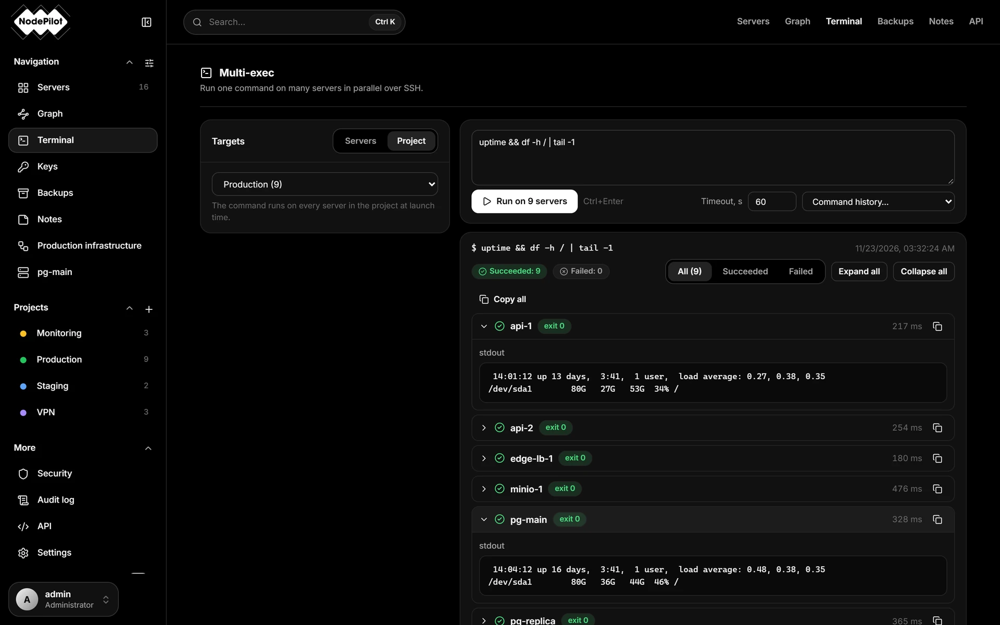
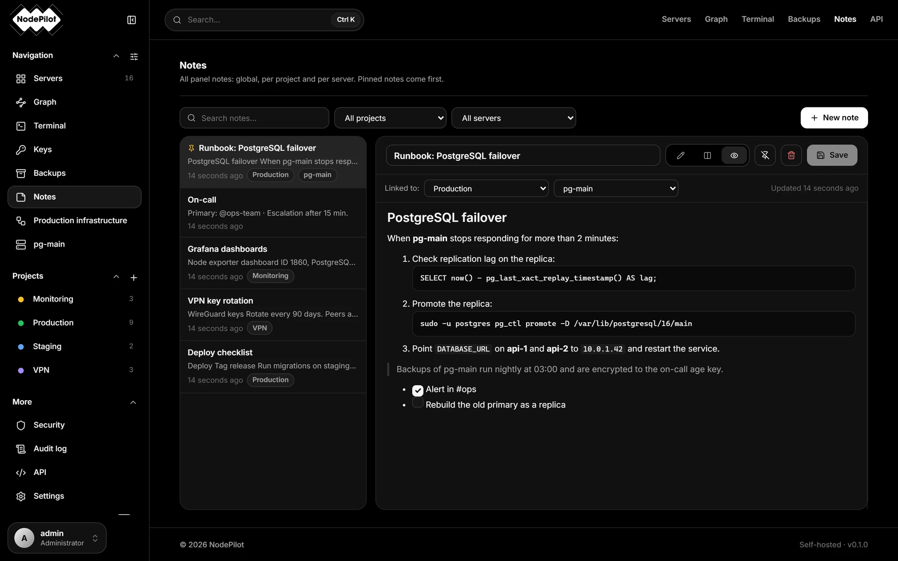
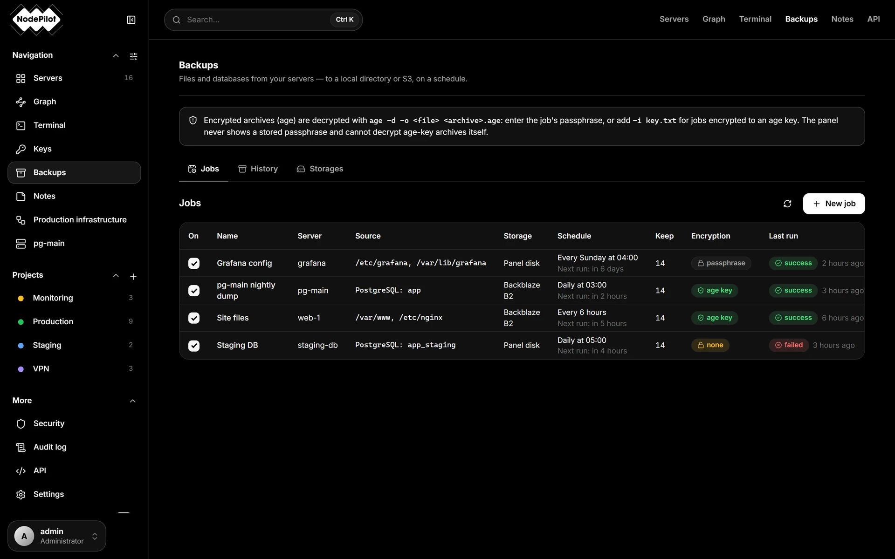
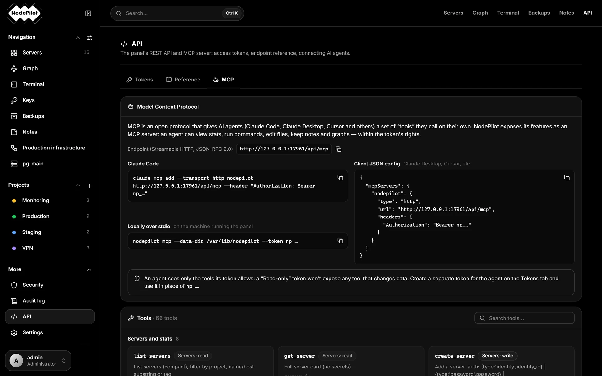
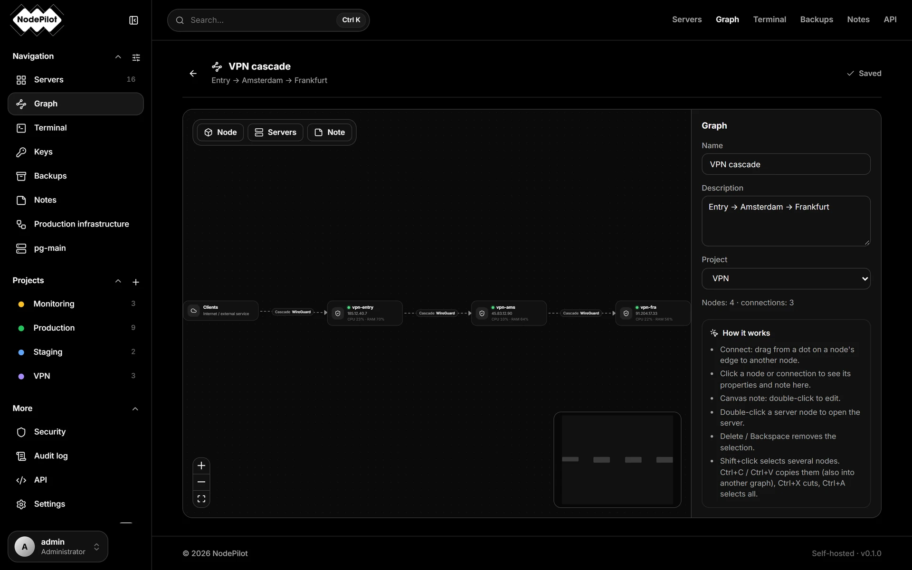
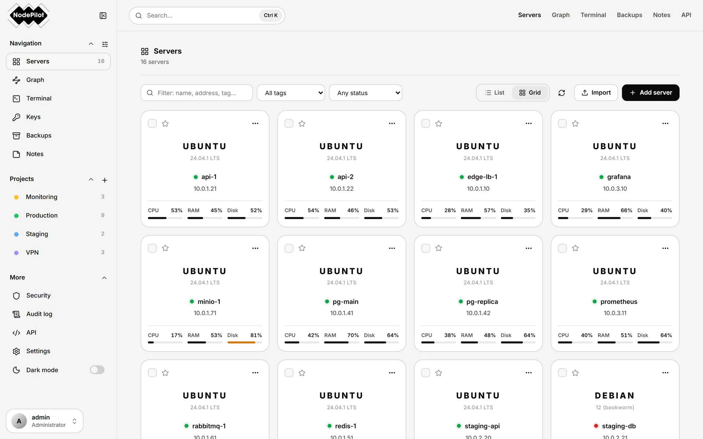
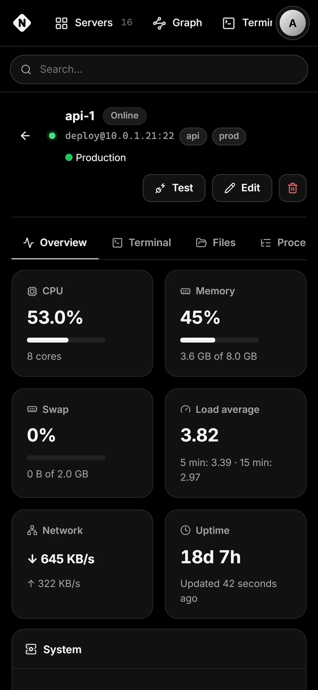

<p align="center">
  <picture>
    <source media="(prefers-color-scheme: dark)" srcset="docs/logo-dark.png">
    
  </picture>
</p>
<p align="center">
  <a href="https://github.com/vlasovmood/nodepilot/stargazers"></a>
  <a href="https://github.com/vlasovmood/nodepilot/releases/latest"></a>
</p>

# NodePilot

**English** · [Русский](README.ru.md)

NodePilot is a self-hosted control panel for your servers: install it on a host and use it from the browser.
It is built to handle hundreds of servers, and AI agents can drive both the panel and the servers over MCP.

<p align="center"></p>

**Features:** projects (a server can belong to several), a keychain, a web terminal, commands on one server
or many at once, agentless stats (CPU, RAM, disks, network, history), a file manager (SFTP), processes and
systemd services, reboot and shutdown, Markdown notes, infrastructure graphs (API/DB/VPN nodes, cascade links,
notes on the canvas), and backups of files and PostgreSQL/MySQL databases to the panel or to S3, with encryption
and schedules.

**UI languages:** English, Русский, Deutsch, Français, 中文, 日本語, العربية (with RTL).

## Screenshots

<table>
  <tr>
    <td width="50%" valign="top"><b>Infrastructure graph linked to live servers</b><br><a href="docs/screenshots/graph.webp"></a></td>
    <td width="50%" valign="top"><b>Server overview and metric history</b><br><a href="docs/screenshots/server.webp"></a></td>
  </tr>
  <tr>
    <td width="50%" valign="top"><b>One command on many servers</b><br><a href="docs/screenshots/exec.webp"></a></td>
    <td width="50%" valign="top"><b>Markdown notes and runbooks</b><br><a href="docs/screenshots/notes.webp"></a></td>
  </tr>
  <tr>
    <td width="50%" valign="top"><b>Scheduled, encrypted backups</b><br><a href="docs/screenshots/backups.webp"></a></td>
    <td width="50%" valign="top"><b>AI agents over MCP</b><br><a href="docs/screenshots/mcp.webp"></a></td>
  </tr>
  <tr>
    <td width="50%" valign="top"><b>VPN cascade</b><br><a href="docs/screenshots/graph-vpn.webp"></a></td>
    <td width="50%" valign="top"><b>Light theme</b><br><a href="docs/screenshots/servers-light.webp"></a></td>
  </tr>
</table>

<p align="center"><br><sub>On a phone</sub></p>

<sub>Screenshots show a demo panel with sample data.</sub>

## Architecture

```
crates/
  nodepilot/        binary: serve | mcp | user | token
  nodepilot-core/   database (SQLite), models, services, stats, backups, secret encryption
  nodepilot-ssh/    SSH: connection pool, exec, PTY, SFTP, metric collection, management commands
  nodepilot-web/    axum: REST API, WebSocket terminal, MCP over HTTP, embedded frontend
  nodepilot-mcp/    MCP tools (stdio and HTTP)
web/                frontend: React + TypeScript (Vite)
docs/API.md         HTTP API contract
packaging/          systemd unit and installer for Ubuntu/Debian
```

How NodePilot scales to hundreds of servers:
- One long-lived SSH connection per server, shared by exec, stats, SFTP and terminals, with keepalive,
  idle shutdown and a limit on how many connections are set up at once.
- Stats come from a single shell script run in a single exec, polled in parallel (32 at a time).
  Unreachable servers are polled with an increasing backoff.
- Metric history lives in SQLite (WAL) and is downsampled to about 600 points per chart.
- Bulk exec runs in parallel with a concurrency limit.

**Security:**
- **Encryption at rest.** Server passwords and keys, database passwords, S3 keys and backup passphrases are
  encrypted with a master key (XChaCha20-Poly1305), which you can seal in a TPM.
- **Credentials.** User passwords are hashed with Argon2id and API tokens with SHA-256.
- **Login protection.** 2FA (TOTP) and brute-force lockout.
- **Panel SSH key.** A dedicated key that servers accept only from the panel's addresses, with rotation and
  emergency revocation.
- **Backups.** Encrypted to an age public key.
- **Audit log.** Forwarded to syslog or a webhook.
- **Host keys.** SSH host key pinning (TOFU).

[SECURITY.md](SECURITY.md) covers the threat model and the recommended setup.

> **Back up `master.key`** together with `nodepilot.db`. Without it, stored credentials cannot be decrypted.

## Development

```sh
cargo run -- serve                       # API + UI at http://127.0.0.1:7780
cd web && npm install && npm run dev     # frontend with hot reload (proxies /api to 7780)
cargo test
```

## Installation

Download a ready-made binary from [Releases](https://github.com/vlasovmood/nodepilot/releases/latest). It is a single file with the
web UI built in:

| Platform | File |
|---|---|
| Linux x86_64 (static, any distribution) | [`nodepilot-linux-x86_64`](https://github.com/vlasovmood/nodepilot/releases/latest/download/nodepilot-linux-x86_64) |
| Linux ARM64 (static) | [`nodepilot-linux-aarch64`](https://github.com/vlasovmood/nodepilot/releases/latest/download/nodepilot-linux-aarch64) |
| Windows x86_64 | [`nodepilot-windows-x86_64.exe`](https://github.com/vlasovmood/nodepilot/releases/latest/download/nodepilot-windows-x86_64.exe) |
| macOS Apple Silicon | [`nodepilot-darwin-aarch64`](https://github.com/vlasovmood/nodepilot/releases/latest/download/nodepilot-darwin-aarch64) |
| macOS Intel | [`nodepilot-darwin-x86_64`](https://github.com/vlasovmood/nodepilot/releases/latest/download/nodepilot-darwin-x86_64) |

Each release also has `SHA256SUMS` for checking the download (`sha256sum -c SHA256SUMS --ignore-missing`).

**Linux server (Ubuntu/Debian, systemd)**, the recommended setup:

```sh
curl -LO https://github.com/vlasovmood/nodepilot/releases/latest/download/nodepilot-linux-x86_64
curl -LO https://github.com/vlasovmood/nodepilot/releases/latest/download/nodepilot-linux-packaging.tar.gz
tar -xzf nodepilot-linux-packaging.tar.gz
chmod +x nodepilot-linux-x86_64
sudo ./packaging/install.sh ./nodepilot-linux-x86_64
```

**Windows:**

```powershell
.\nodepilot-windows-x86_64.exe serve --data-dir C:\NodePilot
```

**macOS:** the binary is not notarized, so clear the quarantine flag once:

```sh
chmod +x nodepilot-darwin-aarch64
xattr -d com.apple.quarantine nodepilot-darwin-aarch64
./nodepilot-darwin-aarch64 serve --data-dir ~/NodePilot
```

On a desktop the panel works while the computer is on: stats history and scheduled backups pause while it sleeps.

**Build from source** (Rust 1.88+, Node.js 22+):

```sh
cd web && npm ci && npm run build && cd ..
cargo build --release -p nodepilot        # target/release/nodepilot
./scripts/build-linux.sh                  # static Linux build on Linux/WSL: needs rustup, musl-tools, node
docker build --target export --output dist .   # or the static Linux build with Docker, on any OS
```

The panel listens on `127.0.0.1:7780`. Expose it through a reverse proxy with TLS, for example Caddy:
`reverse_proxy 127.0.0.1:7780`. In that case, set `NODEPILOT_SECURE_COOKIES=true` in `/etc/nodepilot/nodepilot.env`.

To serve the panel under a sub-path (for example `https://example.com/nodepilot/`), build from source with
`NODEPILOT_BASE_PATH=/nodepilot/` and have the proxy strip the prefix (Caddy: `handle_path /nodepilot/* { reverse_proxy 127.0.0.1:7780 }`).

Docker:

```sh
docker build -t nodepilot .
docker run -d -p 7780:7780 -v nodepilot-data:/var/lib/nodepilot nodepilot
```

Administration:

```sh
nodepilot user passwd admin --password '...'
nodepilot user reset-2fa admin            # if a user lost both their phone and recovery codes
nodepilot token create --user admin --name claude
```

## API and access control

Everything the web UI can do is also available over the HTTP API, so you can build your own client
(a mobile app, for example) or automation. The panel has an **API** section with the endpoint reference,
schemas and a request console. The machine-readable spec is at `GET /api/openapi.json`. It is OpenAPI 3.1,
generated from the code, and you can generate a client from it.

Access uses API tokens (`Authorization: Bearer np_…`), and each token has its own permissions:
**full access**, **read-only**, or **custom** per area (servers, projects, keys, commands and terminal,
processes and services, files, notes, graphs, backups, API tokens) at the "read" or "write" level, plus an
optional expiry. A token cannot issue a token with broader permissions than its own.

Native apps (iOS/Android) don't need CORS. If your client is a web app on another domain, allow it explicitly:
`NODEPILOT_CORS_ORIGINS=https://app.example.com`. Cross-origin calls work only with a Bearer token, not cookies.

```sh
nodepilot token create --user admin --name mobile               # full access
nodepilot token create --user admin --name grafana --read-only --expires-in-days 90
```

## AI agents (MCP)

An AI agent can fully manage the panel within its token's permissions (66 tools with full access):
- projects, servers and keys;
- commands, plus **persistent terminal sessions**, which keep the working directory and environment and
  support interactive programs;
- processes, services and files;
- notes and **graph editing** (nodes, links, notes on the canvas);
- backup storages, jobs and archives.

An agent sees only the tools its token allows, and every call is recorded in the audit log.

- **Remote (HTTP):** `POST https://panel.example.com/api/mcp` with `Authorization: Bearer <API token>`.
  ```sh
  claude mcp add --transport http nodepilot https://panel.example.com/api/mcp --header "Authorization: Bearer np_..."
  ```
- **Local (stdio)** on the panel host: `nodepilot mcp --data-dir /var/lib/nodepilot [--token np_...]`.
  Without `--token`, the agent gets full access.

## Updates

**Settings → Updates** shows the current version, the latest one in the official repository's Releases, and the
release notes. One click installs the update:
1. The panel downloads the build for its platform.
2. It checks the SHA-256 against `SHA256SUMS`.
3. It verifies the Ed25519 signature, if the build set `NODEPILOT_UPDATE_PUBKEY`.
4. It replaces the binary and keeps the previous one alongside with an `.old` extension for rollback
   (`nodepilot.old` with the standard Linux install).
5. It restarts.

The panel checks for updates in the background every 6 hours. Updates are installed only by hand.

- Repository: `NODEPILOT_UPDATE_REPO=owner/name` (release builds set it at build time). Without it, update
  checks are off.
- `packaging/install.sh` puts the binary in `/var/lib/nodepilot/bin`, where the service can write.
- In Docker the panel doesn't update itself. Rebuild the image from the new release and recreate the container
  (`git pull && docker build -t nodepilot .`).
- `.github/workflows/release.yml` builds releases when a `vX.Y.Z` tag is pushed.

## Contributing

Issues and pull requests are welcome. [CONTRIBUTING.md](CONTRIBUTING.md) explains how to build the project, how
it is organized, and which checks to run before opening a PR. New UI strings must be added to every language
at once (see `web/src/i18n/README.md`).

## Code of Conduct

By participating in this project, you agree to follow the [Code of Conduct](CODE_OF_CONDUCT.md)
(based on the Contributor Covenant 2.1).

## Security

Found a vulnerability? **Do not open a public issue.** Report it privately as described in [SECURITY.md](SECURITY.md),
which also covers how to run the panel securely.

## License

[Apache License 2.0](LICENSE). By contributing, you agree that your contributions are licensed under the same terms.
