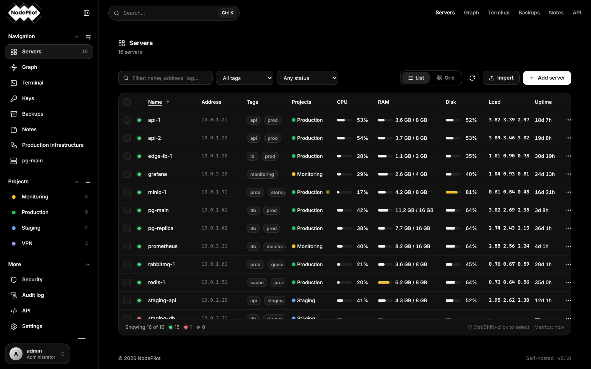
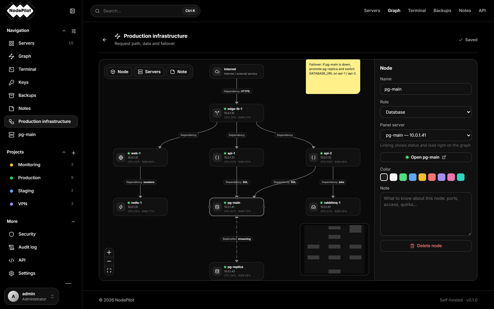
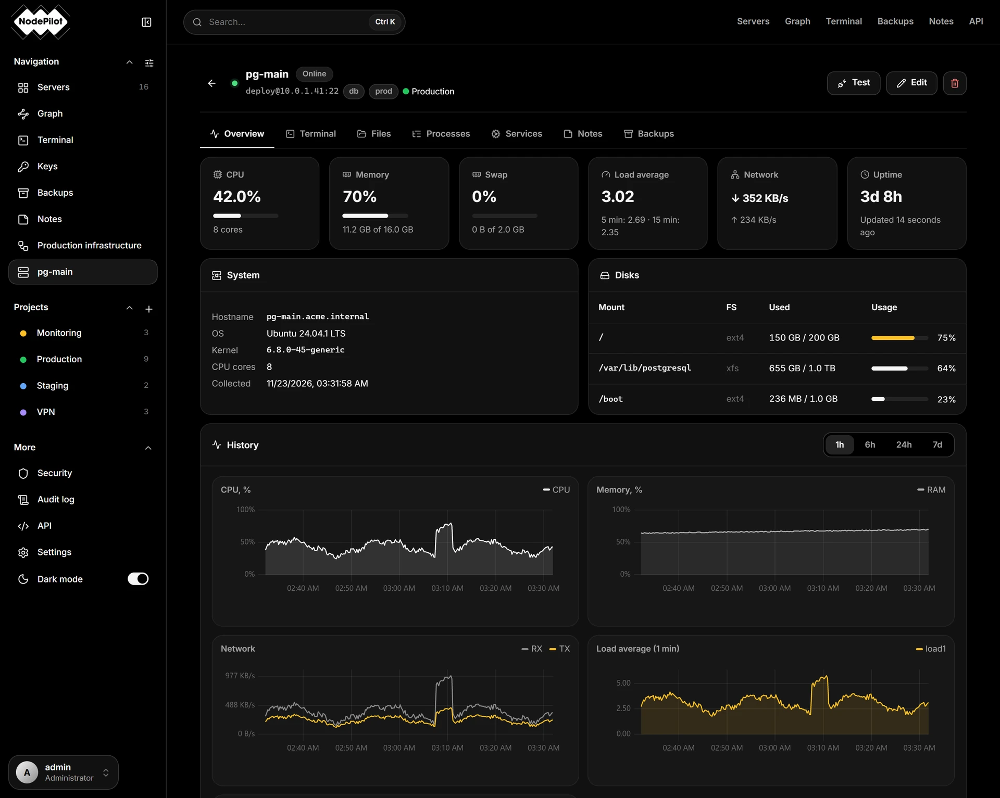
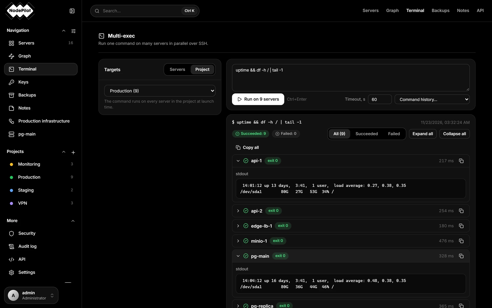
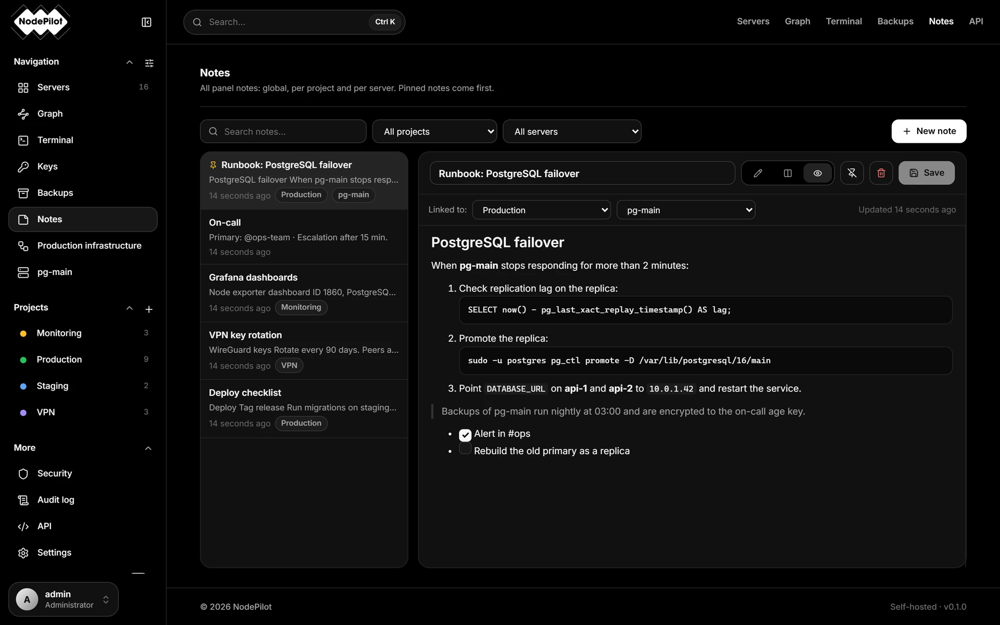
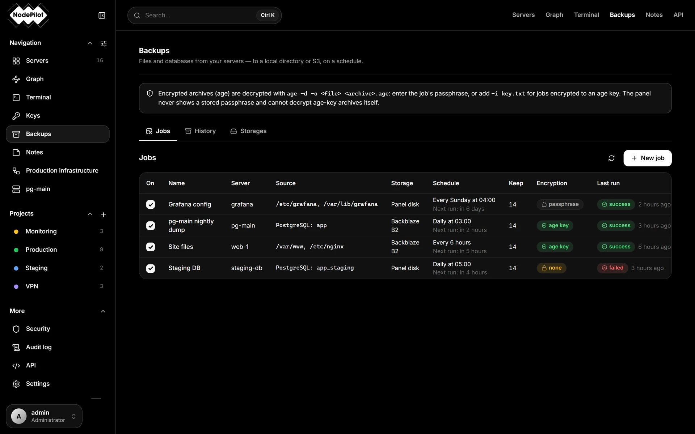
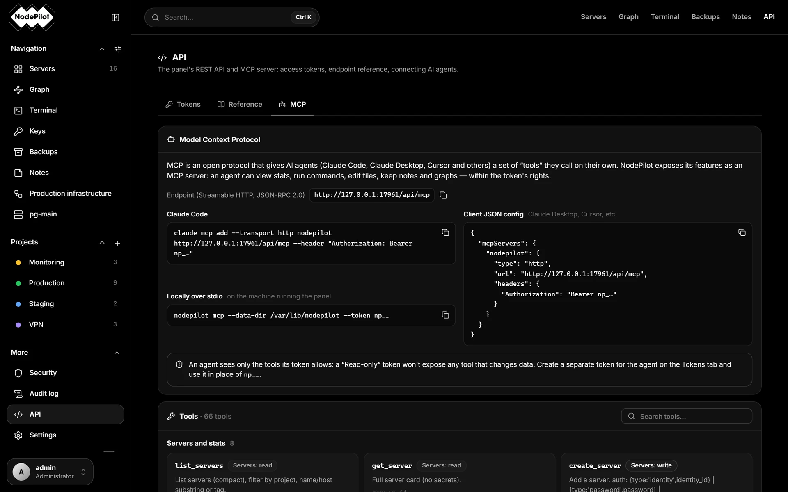
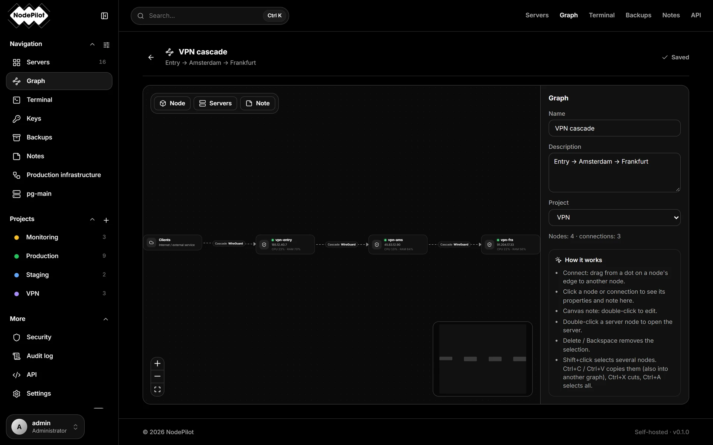
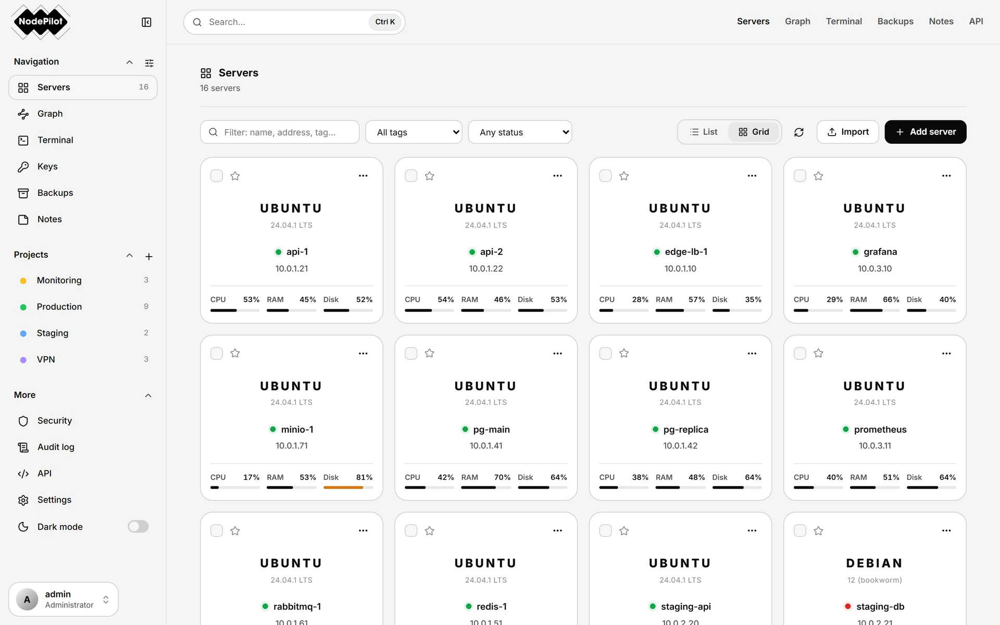
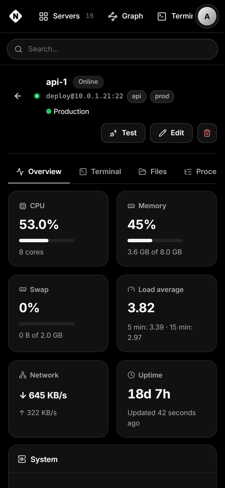

<p align="center">
  <picture>
    <source media="(prefers-color-scheme: dark)" srcset="docs/logo-dark.png">
    
  </picture>
</p>
<p align="center">
  <a href="https://github.com/vlasovmood/nodepilot/stargazers"></a>
  <a href="https://github.com/vlasovmood/nodepilot/releases/latest"></a>
</p>

# NodePilot

[English](README.md) · **Русский**

Self-hosted панель управления серверами: ставится на сервер, открывается в браузере.
Рассчитана на сотни серверов. Нейросети управляют панелью и серверами через MCP.

<p align="center"></p>

**Возможности:** проекты (сервер может входить в несколько), связка ключей, веб-терминал,
выполнение команд на одном или сразу на многих серверах, статистика без агента (CPU, RAM, диски,
сеть, история), файловый менеджер (SFTP), процессы и systemd-сервисы, перезагрузка и выключение,
заметки в Markdown, графы инфраструктуры (ноды API/БД/VPN, связи-каскады, заметки на схеме), бекапы файлов и баз PostgreSQL/MySQL на панель или в S3 с шифрованием и расписанием.

**Языки интерфейса:** English, Русский, Deutsch, Français, 中文, 日本語, العربية (с RTL).

## Скриншоты

<table>
  <tr>
    <td width="50%" valign="top"><b>Граф инфраструктуры со статусом серверов</b><br><a href="docs/screenshots/graph.webp"></a></td>
    <td width="50%" valign="top"><b>Обзор сервера и история метрик</b><br><a href="docs/screenshots/server.webp"></a></td>
  </tr>
  <tr>
    <td width="50%" valign="top"><b>Одна команда на многих серверах</b><br><a href="docs/screenshots/exec.webp"></a></td>
    <td width="50%" valign="top"><b>Заметки и runbook-и в Markdown</b><br><a href="docs/screenshots/notes.webp"></a></td>
  </tr>
  <tr>
    <td width="50%" valign="top"><b>Бекапы по расписанию с шифрованием</b><br><a href="docs/screenshots/backups.webp"></a></td>
    <td width="50%" valign="top"><b>ИИ-агенты через MCP</b><br><a href="docs/screenshots/mcp.webp"></a></td>
  </tr>
  <tr>
    <td width="50%" valign="top"><b>Каскад VPN</b><br><a href="docs/screenshots/graph-vpn.webp"></a></td>
    <td width="50%" valign="top"><b>Светлая тема</b><br><a href="docs/screenshots/servers-light.webp"></a></td>
  </tr>
</table>

<p align="center"><br><sub>На телефоне</sub></p>

<sub>Скриншоты сделаны на демо-панели с примерными данными; язык интерфейса переключается в меню пользователя.</sub>

## Архитектура

```
crates/
  nodepilot/        бинарник: serve | mcp | user | token
  nodepilot-core/   БД (SQLite), модели, сервисы, статистика, бекапы, шифрование секретов
  nodepilot-ssh/    SSH: пул соединений, exec, PTY, SFTP, сбор метрик, команды управления
  nodepilot-web/    axum: REST API, WebSocket-терминал, MCP по HTTP, встроенный фронтенд
  nodepilot-mcp/    MCP-инструменты (stdio и HTTP)
web/                фронтенд: React + TypeScript (Vite)
docs/API.md         контракт HTTP API
packaging/          systemd-юнит и установщик для Ubuntu/Debian
```

Что сделано для работы с сотнями серверов:
- одно долгоживущее SSH-соединение на сервер, его используют exec, статистика, SFTP и терминалы;
  keepalive, закрытие по простою, лимит одновременных подключений;
- статистика собирается одним shell-скриптом за один exec, параллельно (по умолчанию 32 потока),
  для недоступных серверов опрос откладывается всё дольше;
- история метрик хранится в SQLite (WAL) и прореживается до ~600 точек на график;
- массовый exec выполняется параллельно с ограничением.

Безопасность: пароли и ключи серверов, пароли БД, ключи S3 и пароли бекапов зашифрованы мастер-ключом
(XChaCha20-Poly1305), который можно запечатать в TPM; пароли пользователей — Argon2id, токены — SHA-256;
2FA (TOTP) и блокировка перебора; собственный ключ панели, который серверы принимают только с её адресов,
с ротацией и аварийным отзывом; бекапы на публичный ключ age; журнал действий с пересылкой в syslog/webhook;
закрепление ключа хоста SSH (TOFU). Модель угроз и рекомендуемая настройка — в [SECURITY.md](SECURITY.md).

> **Сохраните `master.key`** вместе с `nodepilot.db`: без него сохранённые учётные данные не расшифровать.

## Разработка

```sh
cargo run -- serve                 # API + UI на http://127.0.0.1:7780
cd web && npm install && npm run dev   # фронтенд с hot reload (проксирует /api на 7780)
cargo test
```

## Установка

Готовый бинарник — в [Releases](https://github.com/vlasovmood/nodepilot/releases/latest). Это один файл со встроенным веб-интерфейсом:

| Платформа | Файл |
|---|---|
| Linux x86_64 (статический, любой дистрибутив) | [`nodepilot-linux-x86_64`](https://github.com/vlasovmood/nodepilot/releases/latest/download/nodepilot-linux-x86_64) |
| Linux ARM64 (статический) | [`nodepilot-linux-aarch64`](https://github.com/vlasovmood/nodepilot/releases/latest/download/nodepilot-linux-aarch64) |
| Windows x86_64 | [`nodepilot-windows-x86_64.exe`](https://github.com/vlasovmood/nodepilot/releases/latest/download/nodepilot-windows-x86_64.exe) |
| macOS Apple Silicon | [`nodepilot-darwin-aarch64`](https://github.com/vlasovmood/nodepilot/releases/latest/download/nodepilot-darwin-aarch64) |
| macOS Intel | [`nodepilot-darwin-x86_64`](https://github.com/vlasovmood/nodepilot/releases/latest/download/nodepilot-darwin-x86_64) |

В каждом релизе есть `SHA256SUMS` для проверки загрузки (`sha256sum -c SHA256SUMS --ignore-missing`).

**Linux-сервер (Ubuntu/Debian, systemd)** — рекомендуемый вариант:

```sh
curl -LO https://github.com/vlasovmood/nodepilot/releases/latest/download/nodepilot-linux-x86_64
curl -LO https://github.com/vlasovmood/nodepilot/releases/latest/download/nodepilot-linux-packaging.tar.gz
tar -xzf nodepilot-linux-packaging.tar.gz
chmod +x nodepilot-linux-x86_64
sudo ./packaging/install.sh ./nodepilot-linux-x86_64
```

**Windows:**

```powershell
.\nodepilot-windows-x86_64.exe serve --data-dir C:\NodePilot
```

**macOS:** бинарник не нотаризован, поэтому один раз снимите флаг карантина:

```sh
chmod +x nodepilot-darwin-aarch64
xattr -d com.apple.quarantine nodepilot-darwin-aarch64
./nodepilot-darwin-aarch64 serve --data-dir ~/NodePilot
```

На обычном компьютере панель работает, пока он включён: во время сна статистика и бекапы по расписанию не идут.

**Сборка из исходников** (Rust 1.88+, Node.js 22+):

```sh
cd web && npm ci && npm run build && cd ..
cargo build --release -p nodepilot        # target/release/nodepilot
./scripts/build-linux.sh                  # статическая сборка под Linux на Linux/WSL: нужны rustup, musl-tools, node
docker build --target export --output dist .   # или статическая сборка под Linux через Docker, на любой ОС
```

Панель слушает `127.0.0.1:7780`. Наружу её лучше открывать через reverse proxy с TLS, например Caddy:
`reverse_proxy 127.0.0.1:7780`. В этом случае включите `NODEPILOT_SECURE_COOKIES=true` в `/etc/nodepilot/nodepilot.env`.

Чтобы открыть панель по подпути (например, `https://example.com/nodepilot/`), соберите панель из исходников с
`NODEPILOT_BASE_PATH=/nodepilot/`, а прокси пусть срезает префикс (Caddy: `handle_path /nodepilot/* { reverse_proxy 127.0.0.1:7780 }`).

Docker:

```sh
docker build -t nodepilot .
docker run -d -p 7780:7780 -v nodepilot-data:/var/lib/nodepilot nodepilot
```

Администрирование:

```sh
nodepilot user passwd admin --password '...'
nodepilot user reset-2fa admin            # если потеряны и телефон, и коды восстановления
nodepilot token create --user admin --name claude
```

## API и права доступа

Всё, что умеет веб-интерфейс, доступно через HTTP API — можно написать свой клиент (например, мобильное приложение)
или автоматизацию. Справочник со схемами и консолью запросов — в панели, раздел **API**; машиночитаемая
спецификация — `GET /api/openapi.json` (OpenAPI 3.1, генерируется из кода; из неё можно сгенерировать клиент).

Доступ — по API-токенам (`Authorization: Bearer np_…`), у каждого токена свои права:
**полный доступ**, **только чтение** или **выборочно** по областям (серверы, проекты, ключи, команды и терминал,
процессы и сервисы, файлы, заметки, графы, бекапы, API-токены) с уровнем «чтение» или «запись», плюс срок действия.
Токен не может выпустить токен с правами шире своих.

Нативным приложениям (iOS/Android) CORS не нужен. Если ваш клиент — веб-приложение на другом домене, разрешите его явно:
`NODEPILOT_CORS_ORIGINS=https://app.example.com` (только запросы с Bearer-токеном, без cookie).

```sh
nodepilot token create --user admin --name mobile               # полный доступ
nodepilot token create --user admin --name grafana --read-only --expires-in-days 90
```

## Нейросети (MCP)

ИИ-агент управляет панелью полностью — в пределах прав своего токена (66 инструментов при полном доступе):
проекты, серверы, ключи, команды и **постоянные терминальные сессии** (сохраняют каталог и окружение, работают
интерактивные программы), процессы и сервисы, файлы, заметки, **редактирование графов** (ноды, связи, заметки на холсте),
хранилища, задания и архивы бекапов. Агент видит только разрешённые токену инструменты.

- **Удалённо (HTTP):** `POST https://panel.example.com/api/mcp` с `Authorization: Bearer <API-токен>`.
  ```sh
  claude mcp add --transport http nodepilot https://panel.example.com/api/mcp --header "Authorization: Bearer np_..."
  ```
- **Локально (stdio)** на машине с панелью: `nodepilot mcp --data-dir /var/lib/nodepilot [--token np_...]`
  (без `--token` — полный доступ).

## Обновления

**Настройки → Обновления** показывает текущую и последнюю версию из Releases официального репозитория, описание
релиза и устанавливает обновление одной кнопкой: панель скачивает файл для своей платформы, сверяет SHA-256
из `SHA256SUMS`, проверяет подпись Ed25519 (если при сборке задан `NODEPILOT_UPDATE_PUBKEY`), заменяет бинарник
(предыдущий остаётся рядом как `nodepilot.old` для отката) и перезапускается. Фоновая проверка — раз в 6 часов,
устанавливается обновление только вручную.

- Репозиторий: `NODEPILOT_UPDATE_REPO=owner/name` (по умолчанию задаётся при сборке релиза).
- Установка через `packaging/install.sh` кладёт бинарник в `/var/lib/nodepilot/bin`, куда сервис может писать.
- В Docker панель не обновляет себя — обновите образ (`docker compose pull && docker compose up -d`).
- Релизы собирает `.github/workflows/release.yml` по тегу `vX.Y.Z`.

## Участие в проекте

Мы рады issues и pull request'ам. Как собрать проект, как он устроен и какие проверки пройти перед PR —
в [CONTRIBUTING.md](CONTRIBUTING.md). Новые тексты интерфейса добавляются сразу во все языки
(правила — `web/src/i18n/README.md`).

## Кодекс поведения

Участвуя в проекте, вы соглашаетесь соблюдать [кодекс поведения](CODE_OF_CONDUCT.md)
(на основе Contributor Covenant 2.1).

## Безопасность

Нашли уязвимость — **не создавайте публичный issue**, сообщите приватно по инструкции в [SECURITY.md](SECURITY.md).
Там же — рекомендации по безопасной эксплуатации панели.

## Лицензия

[Apache License 2.0](LICENSE). Присылая изменения, вы соглашаетесь распространять их под этой лицензией.
